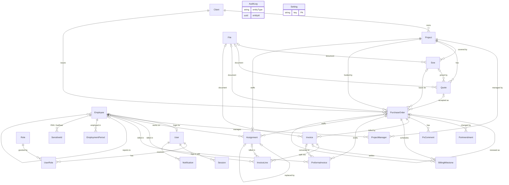
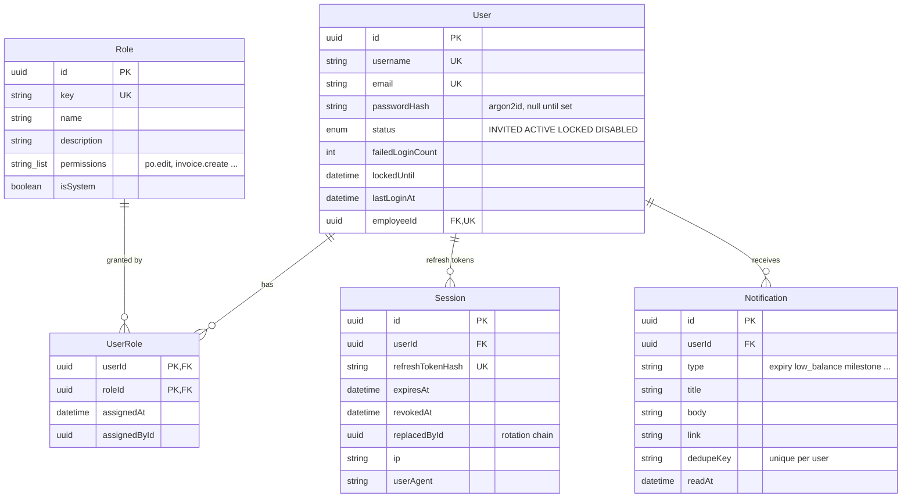
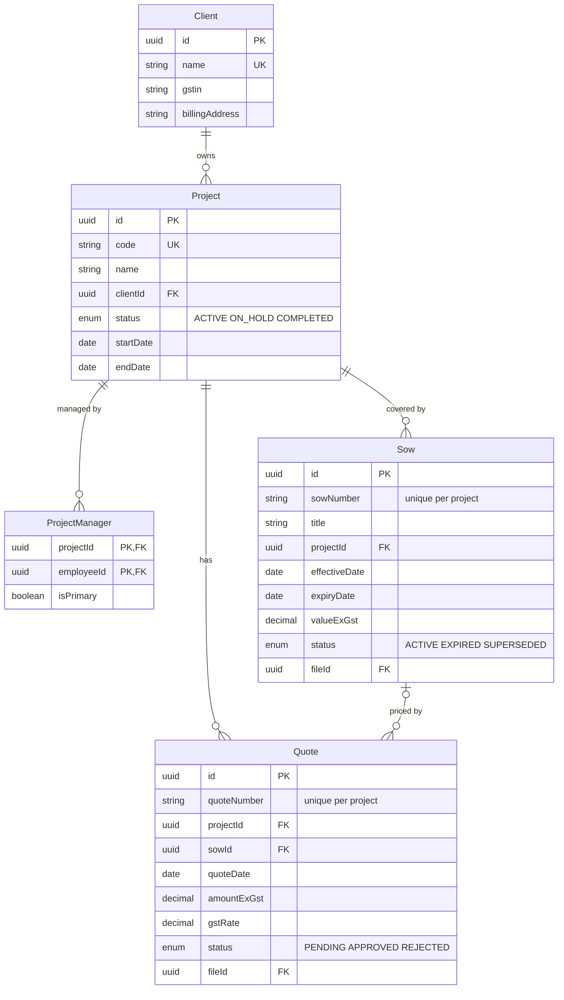
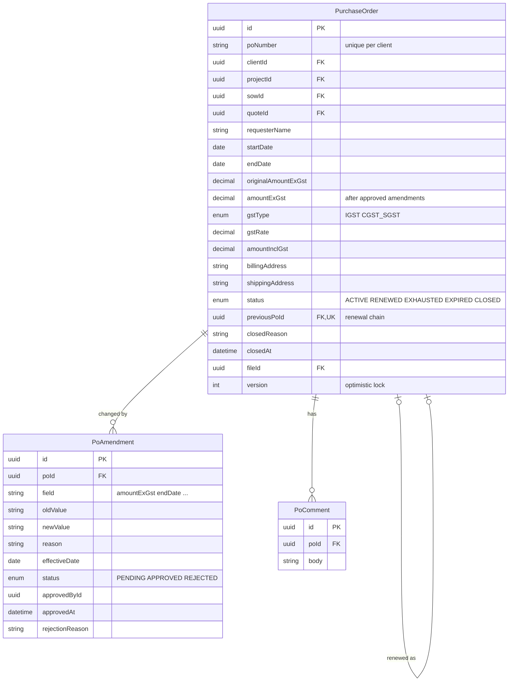
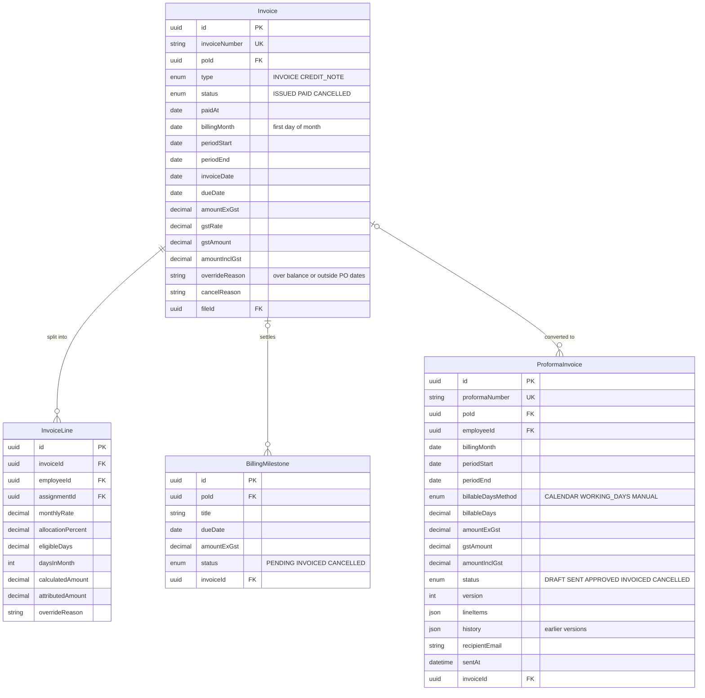
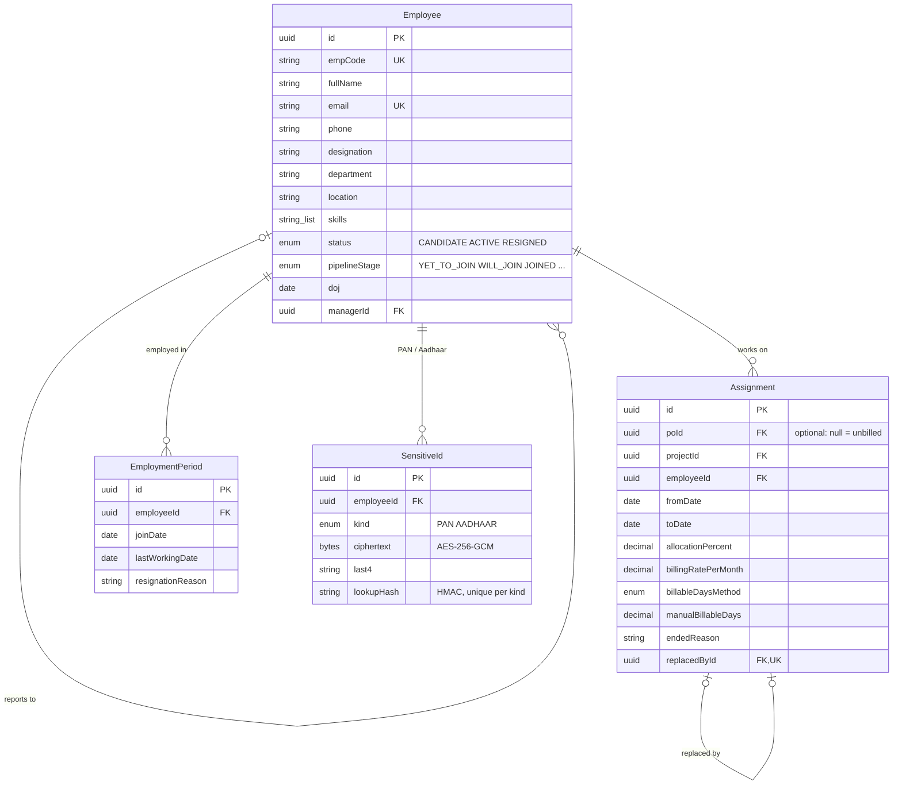
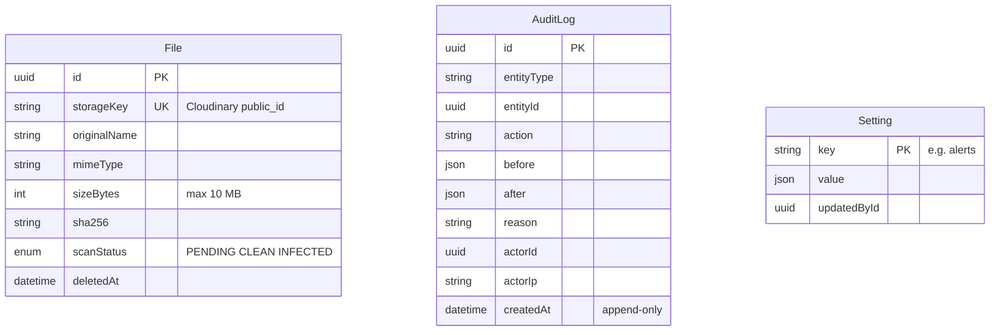

# Database ER diagram

Phase 1 data model from `packages/db/prisma/schema.prisma` (PostgreSQL 17 on Neon), compared with what the frontend screens need. The frontend checked is the active static build in the `HRMS-PrimeStar` repo, `po-only` branch, including its uncommitted work.

Every table also has `createdAt`, `updatedAt` and `createdById`. These are left out of the diagrams to keep them readable. IDs are UUID v7. Money is `Decimal(14,2)`, and dates are plain dates in India time.

## 1. Overview

All 23 tables and how they connect. Read `||--o{` as "one to many" and `|o--o{` as "optional one to many".

`AuditLog` points at any table through `entityType` + `entityId`, so it has no foreign keys. `Setting` holds the alert thresholds and recipient roles that the daily alert job reads.

## 2. Users and access

## 3. Clients, projects and contracts

## 4. Purchase orders

The remaining balance isn't stored. It's worked out as `amountExGst − issued invoices + credit notes`, ignoring cancelled invoices. "Expiring soon" and "running low" are warnings worked out each day, not stored statuses.

## 5. Billing

## 6. Employees and assignments

## 7. Files, audit and settings

---

## Gaps between the frontend and the schema

These are things the screens on `po-only` use that the schema can't store yet. They're proposals only; none are applied. Each one needs a decision before the first migration.

| # | Frontend screen | What the UI does | Schema today | Proposed change |
| --- | --- | --- | --- | --- |
| 1 | Assignments | An assignment can be saved with a project and **no PO** (`poId` optional) | ✅ **Decided: allowed.** Done in the schema | `poId` is now optional and the table is renamed `Assignment`. Assignments without a PO are flagged as unbilled. |
| 2 | Assignments | Status **On Hold**, a free-text **notes** field, termination date and reason | Only `toDate` and `endedReason` | Add `onHold boolean` (or `status` enum) and `notes`. Termination maps to `toDate` + `endedReason`. |
| 3 | Invoices, PO detail | Status dropdown includes **Paid** and **Pending** | ✅ **Decided: in scope, kept small.** Done in the schema | `PAID` status + `paidAt` + `paidById`. No part payments. "Pending" in the UI means `ISSUED` and not yet paid. |
| 4 | Documents | Upload any document (type, linked project or PO, expiry date, notes, status Verified) | `File` holds only bytes metadata, linked from SOW/Quote/PO/Invoice | Add a `Document` table: `fileId, type, projectId?, poId?, expiryDate?, notes, status` |
| 5 | PO amend modal | Amendment has a **document reference** | No field | Add `PoAmendment.fileId` (or `documentRef` text) |
| 6 | Users & Roles, login | Invite link, password reset link, **must change password** flag | No token storage, no flag | Add `UserToken` table (`userId, kind INVITE/RESET, tokenHash, expiresAt, usedAt`) and `User.mustChangePassword` |
| 7 | Users & Roles | Users have a display **name**, even when not linked to an employee | `User` has only `username` and `email` | Add `User.name` |
| 8 | Users & Roles | CEO role is **locked** (its permissions can't change) | Only `isSystem` (can't delete) | Add `Role.isLocked` |
| 9 | Projects / PO create | Client is typed as a name; SOW number is free text on the PO form | `Client` and `Sow` are real tables | Keep the schema. The PO form should pick a client and SOW from lists, or create them inline. |
| 10 | PO tracker | **Delete PO** button | ✅ **Decided: no hard delete** (Architecture doc: POs are never hard-deleted) | Frontend: replace Delete with **Close PO** plus a reason. A PO created by mistake is closed with the reason "Created in error". No schema change. |
| 11 | PO create | No **GST type** field | ✅ **Decided: pre-filled and editable** | Add `PurchaseOrder.billingState`. GST type is pre-filled from the PO's billing state vs Prime Star's state (a company setting): same state gives CGST + SGST, different gives IGST. The user can change it. |

**These need no change, only mapping in the API:**

| Frontend | Database |
| --- | --- |
| PO status `Expiring Soon`, `Low Balance` | Worked out from `endDate` and balance, not stored |
| PO status `Fully Utilized` | `EXHAUSTED` |
| Milestone `Upcoming` | `PENDING` |
| Project headcount, total PO value, remaining balance | Worked out from assignments, POs and invoices |
| PO activity log, access audit log | `AuditLog` rows |
| Alert settings screen | `Setting` row with key `alerts` |
| Data import | Normal inserts plus `AuditLog`, no extra table |
